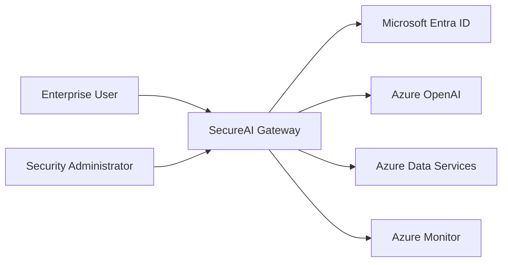
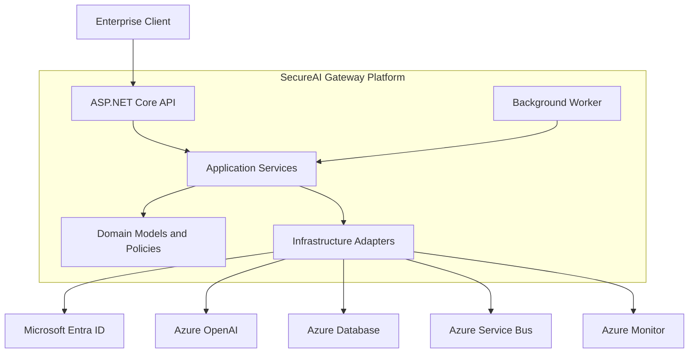
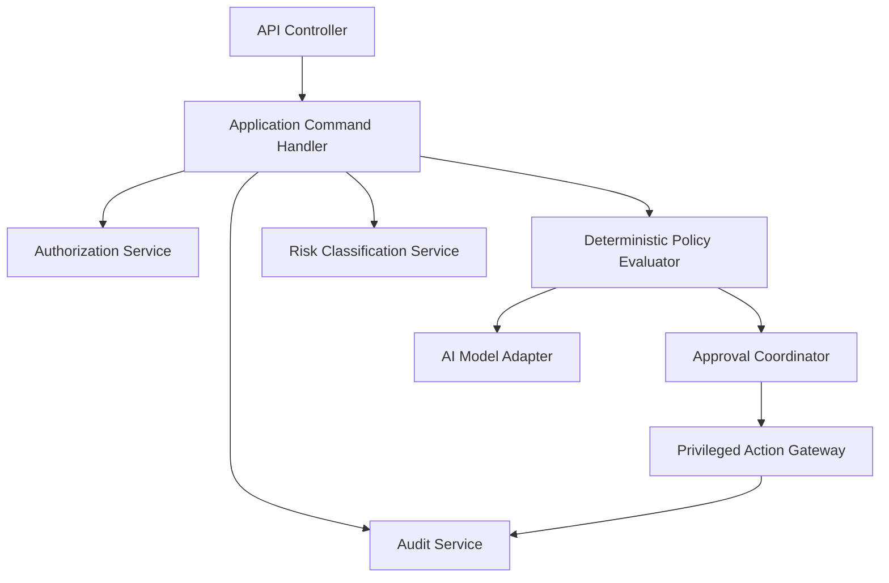

# SecureAI Gateway — Architecture

## 1. Architecture Overview

SecureAI Gateway is an enterprise AI governance platform designed to provide secure, auditable, policy-controlled access to AI capabilities.

The platform uses Clean Architecture to separate business rules, application orchestration, infrastructure integrations, and HTTP interfaces.

### Architectural Principles

1. Security controls must be enforced independently of AI model output.
2. Authorization must be verified before accessing protected resources.
3. AI-generated instructions must not bypass deterministic policy enforcement.
4. Every privileged operation must produce an auditable decision record.
5. Infrastructure dependencies must remain outside the domain layer.
6. Failures must be handled safely without bypassing security controls.

## 2. C4 Level 1 — System Context



### System Responsibilities

SecureAI Gateway is responsible for:

- Authenticating enterprise users.
- Authorizing access to AI operations.
- Evaluating deterministic security policies.
- Managing AI request lifecycles.
- Enforcing approval requirements.
- Recording audit evidence.
- Controlling access to enterprise data and external services.

## 3. C4 Level 2 — Container Architecture



### Container Responsibilities

| Container | Responsibility |
|---|---|
| API | HTTP endpoints, authentication integration, request validation |
| Application | Use cases, orchestration, authorization coordination |
| Domain | Business entities, invariants, risk classifications |
| Infrastructure | Azure services, persistence, messaging, model adapters |
| Worker | Durable background processing and asynchronous tasks |

## 4. C4 Level 3 — Application Components



### Dependency Direction

The intended dependency direction is:

```text
API -> Application -> Domain

Infrastructure -> Application
Infrastructure -> Domain
```

The Domain layer must not depend on API, Application, or Infrastructure.

Application services should depend on abstractions rather than concrete Azure SDK implementations.

## 5. Trust Boundaries

The platform establishes the following trust boundaries.

### Boundary 1 — External Client to API

Controls:

- TLS encryption.
- Microsoft Entra ID authentication.
- Token validation.
- Request size limits.
- Input validation.
- Rate limiting.

### Boundary 2 — API to Application

Controls:

- Authorization checks.
- Tenant-context validation.
- Request correlation.
- Explicit command validation.

### Boundary 3 — Application to AI Model

Controls:

- Prompt-injection defenses.
- Data classification enforcement.
- Restricted context retrieval.
- Model output treated as untrusted.
- Deterministic policy evaluation.

### Boundary 4 — Application to Privileged Actions

Controls:

- Explicit action allowlists.
- Risk classification.
- Approval verification.
- Least-privilege credentials.
- Audit evidence.
- Idempotency and replay protection.

### Boundary 5 — Platform to Azure Resources

Controls:

- Managed identities.
- Azure RBAC.
- Private endpoints where supported.
- Controlled network egress.
- Encryption at rest and in transit.

## 6. Technology Stack

| Layer | Technology |
|---|---|
| API | ASP.NET Core |
| Application | .NET |
| Domain | C# |
| Infrastructure | Azure SDKs |
| Identity | Microsoft Entra ID |
| AI Models | Azure OpenAI |
| Messaging | Azure Service Bus |
| Secrets | Azure Key Vault |
| Monitoring | Azure Monitor / Application Insights |
| Infrastructure as Code | Terraform |
| CI/CD | GitHub Actions |
| Testing | xUnit |

These are planned architectural components. Their inclusion in this document does not imply they have already been deployed.

## 7. Failure Handling

### Authentication Failure

Reject the request and return an appropriate HTTP authentication response.

### Authorization Failure

Reject the request without disclosing protected resource details.

### Policy Evaluation Failure

Fail closed. Do not execute privileged actions.

### AI Model Failure

Apply bounded retries only when safe. Record the failure and return a controlled error.

### Approval Service Failure

Keep the operation pending or reject it. Never treat a missing approval response as approval.

### Messaging Failure

Use retry policies, dead-letter handling, and idempotent processing.

### Audit Persistence Failure

Privileged operations requiring durable audit evidence must not proceed without the required evidence guarantees.

## 8. Security and Governance References

- [Threat Model](../security/threat-model.md)
- [Risk Policy](../security/risk-policy.md)
- [Authorization Matrix](../security/authorization-matrix.md)
- [ADR-0001: Platform Boundaries](../adr/0001-platform-boundaries.md)
- [ADR-0002: Deterministic Policy](../adr/0002-deterministic-policy.md)

## 9. Implementation Status

This document defines the target architecture for SecureAI Gateway.

The implementation will be delivered incrementally through subsequent project phases.