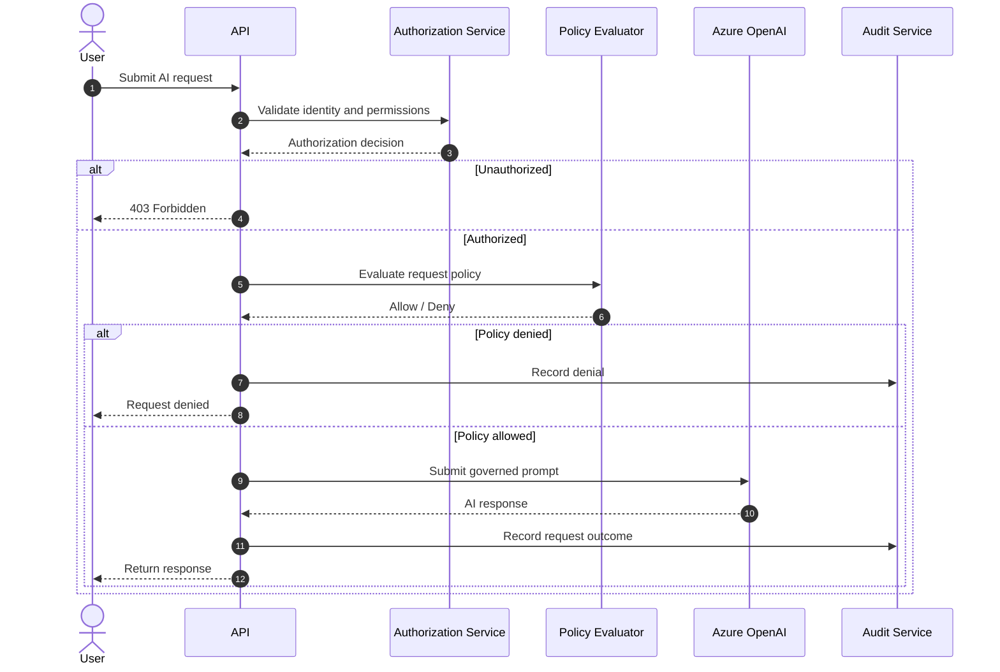
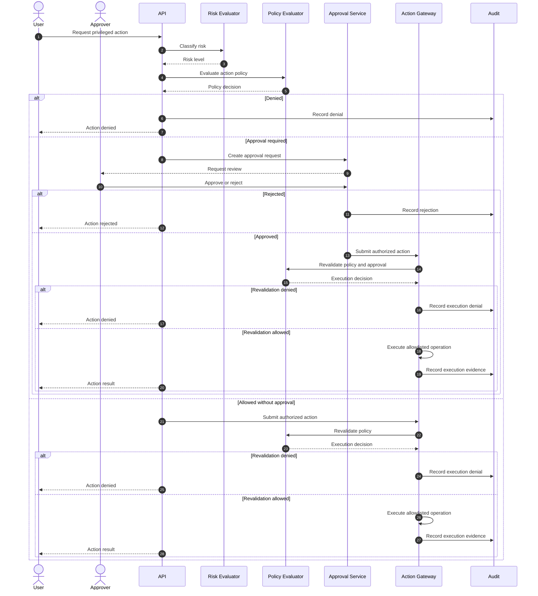
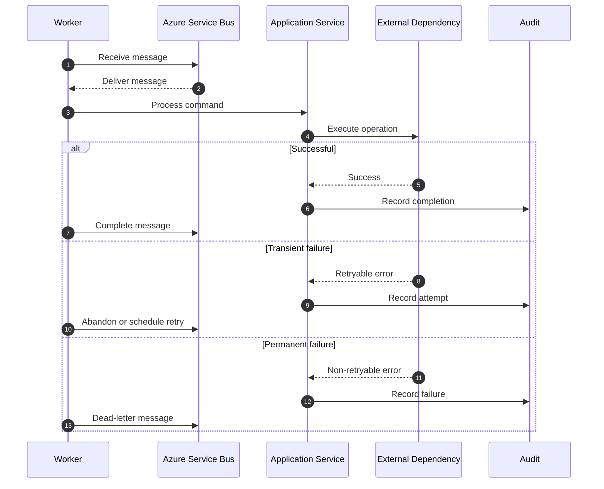

# SecureAI Gateway — Sequence Diagrams

## 1. Standard AI Request Lifecycle

## 2. Privileged Action Approval Workflow

## 3. Failure and Retry Handling

## 4. Security Requirements

The implementation must enforce:

- Authentication before protected API access.
- Tenant-scoped authorization.
- Deterministic policy checks.
- Explicit approval for actions requiring human review.
- Policy revalidation immediately before privileged execution.
- Auditable approval and execution decisions.
- Idempotent message handling.
- Bounded retries and dead-letter processing.
- Fail-closed behavior for security-critical dependencies.

## 5. Implementation Notes

These diagrams describe intended application behavior.

The implementation will be introduced incrementally in later phases, with automated tests verifying the security-critical paths.
